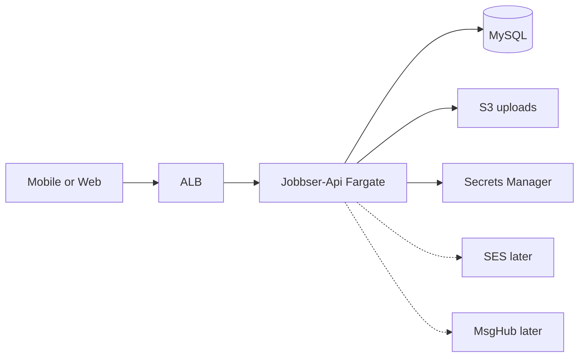

# Task 2: Terraform repo + GitHub Actions for Jobbser-style AWS

**Name:** Roshan Joshi  
**Task:** 2  
**Time spent:** ~3.5 hours

Design files only. No live AWS account, no real secrets, no apply against Jobbser.

---

## What I read first

I used the AWS inventory pack. Jobbser already runs roughly:

- ECS Fargate for **Jobbser-Api** and **JobbserMsgHub**
- ALB + VPC
- RDS MySQL
- S3 uploads
- SES email
- Secrets Manager for runtime config
- Dev has been expensive when left always-on

I am not importing today’s Prod. Infra today is mostly operational. This repo is
a greenfield layout that matches that shape so a team could stand up Dev cleanly
and migrate later.

Workers stay free in the product. That does not change the Terraform much. It
just means I am not inventing billing infra for workers.

---

## First slice

I did not try to Terraform every box on the inventory in one sitting. That would
be a folder of empty modules.

What I built:

1. Tagging / naming contract (`shared/tagging.md`) so Cost Explorer does not
   become a junk drawer.
2. Remote state bootstrap (S3 + DynamoDB lock).
3. Edge: VPC + one NAT option + ALB (`modules/vpc-alb`).
4. Runtime secret shell for Jobbser-Api (`modules/api-runtime-secret`).
5. API task security group in the **stack** (not buried in the ECS module).
6. MySQL (`modules/jobbser-mysql`) allowed from that SG.
7. Jobbser-Api on Fargate (`modules/jobbser-api`).
8. Uploads bucket (`modules/upload-bucket`) + IAM glue on the task role.

Wiring lives in `stacks/dev/`. Stretch sketch in `stacks/check/`.

Left out on purpose (notes in `deferred/`):

- SES: need a real sending domain from whoever owns DNS. Fake SES in Terraform
  felt like padding.
- MsgHub: same ECS pattern as the API. I would add it after Dev API is parkable.
  Two always-on services in Dev recreates the cost pain.

### Why this order

I wanted the data plane rules to exist before the service module.

So the stack creates the API SG first, then MySQL references it, then the
Jobbser-Api module consumes the same SG. Slightly awkward. Easier to reason
about “what can talk to the DB?” without opening the ECS module.

I also named modules after Jobbser things (`jobbser-api`, `jobbser-mysql`)
instead of generic `ecs` / `rds`. Easier to map back to the inventory.

---

## Two decisions with trade-offs

**Single NAT in Dev.**  
Inventory calls out NAT + public IPv4 as real money. One NAT is a single point
of failure. For Dev I care more about the bill than AZ-perfect egress. Prod can
do one-per-AZ later. `create_nat=false` + public task IPs is an escape hatch if
even one NAT is too much. Security groups still lock ingress to the ALB.

**Park the API overnight.**  
`park_api=true` sets desired count to 0. The ECS service also `ignore_changes`
on desired_count so someone can park it in the console without Terraform
fighting. ALB still costs money if left up. A schedule would be nicer; I did not
build that here. The apply workflow accepts `park_api` as an input.

---

## Layout

```
shared/tagging.md          # names + tags
bootstrap/                 # state bucket + lock table (once)
modules/
  vpc-alb/
  api-runtime-secret/
  jobbser-mysql/
  jobbser-api/
  upload-bucket/
stacks/
  dev/                     # wired + CI target
  check/                   # stretch second env (not "test", on purpose)
deferred/
  ses.md
  msghub.md
.github/workflows/
  terraform-plan.yml       # PR → plan + artifact
  terraform-apply.yml      # manual dispatch only
docs/
scripts/
```

Names look like `jb-dev-api`, `jb-dev-mysql`. Tags use `jb_project`, `jb_env`,
`jb_component`, `billed_to`. See `shared/tagging.md`.

---

## Picture



More notes: [`docs/architecture.md`](docs/architecture.md).

---

## Remote state

`bootstrap/` creates the S3 bucket and DynamoDB lock table once. Stacks then
point at it, for example:

```hcl
bucket         = "jb-tfstate-example"
key            = "stacks/dev/terraform.tfstate"
region         = "eu-west-1"
dynamodb_table = "jb-tf-locks"
encrypt        = true
```

Dev and check never share a state key.

---

## Plan / apply

| When | Workflow | What happens |
| --- | --- | --- |
| PR touches infra | `tf-plan-dev` | fmt, init, validate, plan. Uploads `tfplan` + `plan.txt` as an artifact. Comments on the PR. |
| Someone changes Dev | `tf-apply-dev` (workflow_dispatch) | Confirm string `apply-dev`. GitHub Environment `dev-apply` for approval. Re-plans on main, then applies. Optional `park_api` input. |

I did **not** auto-apply on push to main. Merge should not secretly turn Dev back
on. OIDC roles are placeholders (`jb-gha-tf-plan` vs `jb-gha-tf-apply`). No
long-lived AWS keys in GitHub.

Local checks I used while writing this:

```bash
cp stacks/dev/terraform.tfvars.example stacks/dev/terraform.tfvars
cp stacks/dev/backend.hcl.example stacks/dev/backend.hcl
make fmt
make validate
```

---

## Cost (inventory “Cost reality”)

Most spend sat in EC2/NAT, public IPv4, ECS/Fargate, ALB. RDS was smaller. Dev
being always-on was bad enough that it got switched off.

Knobs in this repo:

- `park_api`
- one NAT (`create_nat`)
- `db.t4g.micro`, single-AZ, short backups
- 7-day logs in Dev
- Container Insights off

I would not clone a full always-on Prod and call it Dev.

---

## Stretch

- `stacks/check`: second env, own CIDR/state. Data strategy is Task 3 territory.
- Drift: nightly plan with `-detailed-exitcode`, open an issue, do not auto-fix.
- Rollback: revert + re-run apply, or pin an older `api_image_uri`. MySQL PITR for
  data. Only unlock state with a clear reason.

---

## What I would ask in a kickoff

1. Is Dev in the same AWS account as Prod, or is a separate account preferred
   before any of this lands?
2. What is the real health check path and container port on Jobbser-Api today?
   I assumed `/health` and `8080`.
3. Is parking Dev overnight OK for whoever demos the app next morning?
4. Who owns the SES sending domain / DNS? That is why SES is deferred.
5. Who should be the required reviewer on the `dev-apply` GitHub Environment?
6. Is there already a tag taxonomy in billing reports I should match instead of
   `jb_*`?
7. MsgHub next, or TEST/check env next?

---

## Testing approach

No live AWS in this submission. How I would still prove the files:

1. `terraform fmt -check` and `terraform validate` with `-backend=false`
   (`make validate`).
2. Grep the repo for anything that looks like a real key (`AKIA`, `sk_live`,
   real passwords). Placeholders only.
3. On a PR: read the plan. Watch for destroys, `publicly_accessible` on MySQL,
   SG rules that open 3306 to the world, missing tags.
4. Download the plan artifact from Actions and skim `plan.txt`.
5. Apply only through `tf-apply-dev` with Environment approval. Afterward: ALB
   health, ECS count matches `park_api`, MySQL not public, secret ARN on the
   task def.
6. If time allowed: tflint / Checkov, and a deny rule for public RDS.

Longer notes: [`docs/testing-approach.md`](docs/testing-approach.md).

---

## Assumptions

- Region `eu-west-1`.
- Greenfield Dev first. Prod stays as-is for now.
- ACM ARN and ECR image are placeholders.
- One Secrets Manager JSON per env (matches the inventory advice).
- Fargate 256 CPU / 512 MB as a starting point from the inventory examples.
- After first apply, a human updates the secret with a real DB password and
  connection string (Terraform ignores later secret body changes).
